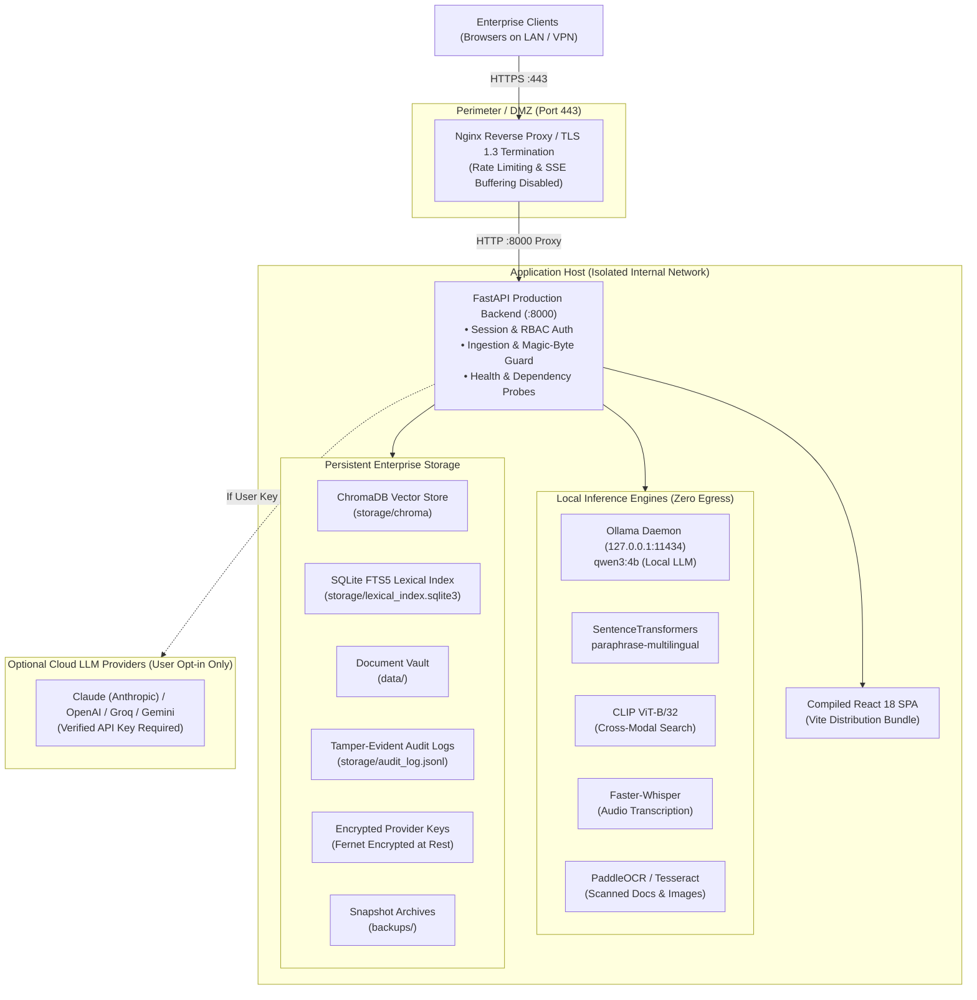

# Enterprise Production Deployment & Operational Readiness Guide (Phase 7)

**Target Release:** `v2.0-enterprise`  
**Git Branch:** `enterprise-security-performance`  
**Security Classification:** Highly Confidential / Enterprise On-Premises  

---

## 1. Production Architecture

The platform operates on a defense-in-depth, offline-first architecture. All parsing, OCR, multi-vector embeddings, lexical indexing, and inference execute locally inside the enterprise security perimeter.



### Communication & Isolation Guarantees
- **Ollama Isolation (`127.0.0.1:11434`)**: Bound strictly to localhost; never exposed to public or external LAN interfaces.
- **SQLite FTS5 (`WAL mode`)**: Operates in Write-Ahead Logging mode with automatic checkpointing on backup.
- **ChromaDB (`storage/chroma/`)**: Embedded database directly accessed via Python process memory without external network listeners.
- **FastAPI Backend (`:8000`)**: Accessible only via the local Nginx reverse proxy.

---

## 2. Infrastructure & Hardware Requirements

| Component | Minimum Requirements (CPU-only) | Recommended Production (CUDA Accelerated) |
|---|---|---|
| **CPU** | 4 Cores (x86_64 or ARM64) | 8+ Cores (e.g., AMD EPYC, Intel Xeon, Core i7/i9) |
| **RAM** | 16 GB | 32 GB – 64 GB DDR4/DDR5 |
| **GPU / VRAM** | None (CPU inference supported) | NVIDIA RTX 3060/4060, A4000, A5000 (8 GB+ VRAM, CUDA 12.x) |
| **Storage (System)** | 30 GB SSD | 100 GB+ NVMe SSD |
| **Storage (Documents)** | 50 GB | Sized according to enterprise volume (1 GB per ~2,000 PDFs) |
| **Operating System** | Ubuntu 22.04/24.04 LTS, Windows 10/11 Enterprise | Ubuntu 22.04 LTS or Windows Server 2022 |

### Workload Acceleration Breakdown: CPU vs. GPU
- **LLM Reasoning (Ollama)**: Automatically benefits from CUDA GPU offload. Tokens/sec scales from ~6 tok/s (CPU) to ~45+ tok/s (RTX 4060).
- **Dense Embeddings (SentenceTransformers)**: Fast on CPU (~15ms per chunk); executes in batches of 64 on CUDA (~2ms per chunk).
- **Audio Transcription (Faster-Whisper)**: Runs in int8/float16; real-time audio transcribed 8x faster on CUDA.
- **Document & Spreadsheet Parsing**: CPU-bound (PyMuPDF, python-docx, openpyxl).

---

## 3. Production Deployment Configuration

### 3.1 Linux Deployment (Systemd + Nginx)
1. Copy repository to `/opt/multimodal-rag`.
2. Configure `.env` from template:
   ```bash
   cp .env.production .env
   ```
3. Compile frontend bundle:
   ```bash
   cd frontend && npm install && npm run build && cd ..
   ```
4. Install systemd service:
   ```bash
   sudo cp deploy/systemd/multimodal-rag.service /etc/systemd/system/
   sudo systemctl daemon-reload
   sudo systemctl enable --now multimodal-rag
   ```
5. Install automated backup timer:
   ```bash
   sudo cp deploy/systemd/multimodal-rag-backup.* /etc/systemd/system/
   sudo systemctl daemon-reload
   sudo systemctl enable --now multimodal-rag-backup.timer
   ```
6. Configure Nginx:
   ```bash
   sudo cp deploy/nginx/nginx.conf /etc/nginx/nginx.conf
   sudo systemctl restart nginx
   ```

### 3.2 Windows Deployment (PowerShell)
1. Copy `.env.production` to `.env`.
2. Run production startup script:
   ```powershell
   powershell scripts\start-production.ps1
   ```
3. To stop:
   ```powershell
   powershell scripts\stop-production.ps1
   ```

---

## 4. Cloud Providers & Key Validation (Claude, OpenAI, Groq, Gemini)

Users can optionally augment local Ollama answering with verified cloud providers:

1. **Ingest & Verify Key**:
   - In **Workspace Settings** $\to$ **Model Settings & Local AI Telemetry** or the **Answer Model** panel in the sidebar, input the API key for `Claude`, `OpenAI`, `Groq`, or `Gemini`.
   - Click **Verify** (or **Save**). The backend immediately tests the key using the provider SDK (`models.list()` or lightweight probe).
   - If valid, a green `Verified ✓` badge is displayed and the key is stored in `storage/provider_keys.json` encrypted using AES-256 (Fernet).
2. **Model Selection**:
   - Once verified, the available models for that provider are automatically loaded and rendered in the **Available Models** dropdown.
   - For example:
     - **OpenAI**: `gpt-4o`, `gpt-4o-mini`, `o3-mini`, `o1`, `gpt-4-turbo`.
     - **Claude**: `claude-3-7-sonnet-20250219`, `claude-3-5-sonnet-latest`, `claude-3-5-haiku-latest`, `claude-3-opus-latest`.
     - **Groq**: `llama-3.3-70b-versatile`, `llama-3.1-8b-instant`, `llama-3.2-11b-vision-preview`, `mixtral-8x7b-32768`.
     - **Gemini**: `gemini-2.0-flash`, `gemini-1.5-flash`, `gemini-1.5-pro`.
3. **Activation**:
   - Selecting a model and clicking **Activate Provider** sets that provider and model as the active answer generation engine for that user's session.
   - Retrieval, OCR, and vector indexing remain 100% on-premises.

---

## 5. Monitoring & Operational Health Checks

The backend provides three distinct, unauthenticated monitoring endpoints:

### 1. `/health/live` (Liveness Probe)
- Fast, low-overhead check used by container orchestrators and load balancers.
- Returns `{"status": "alive"}`.

### 2. `/health/ready` (Readiness Probe)
- Verifies that all load-bearing components (Ollama daemon and file storage) are responsive.
- Returns:
  ```json
  {
    "status": "ready",
    "storage": "ok",
    "ollama": "ok"
  }
  ```

### 3. `/health/dependencies` (Full Operational Telemetry)
- Comprehensive health breakdown including SQLite FTS5 status, ChromaDB vector stats, disk storage capacity, circuit breaker health, and hardware telemetry:
  ```json
  {
    "status": "healthy",
    "storage": "ok",
    "vector_db": "ok",
    "sqlite_fts5": "ok",
    "disk": {
      "free_gb": 142.8,
      "total_bytes": 512110190592
    },
    "ollama": {
      "status": "ok",
      "model": "qwen3:4b"
    },
    "circuit_breakers": { ... }
  }
  ```

---

## 6. Backup & Disaster Recovery

### Automated Daily Snapshots
- Scheduled daily via `scripts/run_scheduled_backup.py` (or systemd timer at 02:00 UTC).
- Automatically checks database locks via `PRAGMA wal_checkpoint(FULL)`, archives SQLite indices, ChromaDB vector embeddings, raw documents, session history, and audit logs.
- Verifies archive zip integrity with CRC32 checks (`verify_backup`).
- Enforces a 7-day retention policy, pruning expired snapshots.

### Restoration Procedure
To restore a snapshot in disaster recovery scenarios:
```bash
python -c "from backend.backup_manager import restore_backup; from pathlib import Path; restore_backup(Path('backups/snapshot_YYYYMMDD_HHMMSS.zip'), Path('data/'), Path('storage/'))"
```

---

## 7. Multi-Machine Enterprise Access (LAN / VPN)

To enable workstations across an enterprise local area network (LAN) or corporate VPN:

1. **Firewall Rule**: Open incoming port `443` (HTTPS) on the host server:
   - Linux: `sudo ufw allow 443/tcp`
   - Windows: `New-NetFirewallRule -DisplayName "Multimodal RAG HTTPS" -Direction Inbound -LocalPort 443 -Protocol TCP -Action Allow`
2. **DNS / Host Mapping**: Map `rag.enterprise.local` to the server's private IP address in enterprise DNS.
3. **Client Access**:
   - Users browse to `https://rag.enterprise.local`.
   - Session authentication is governed by encrypted tokens with role-based isolation (`admin` vs `user`).
   - Tenant isolation prevents cross-tenant document or collection leakage.
